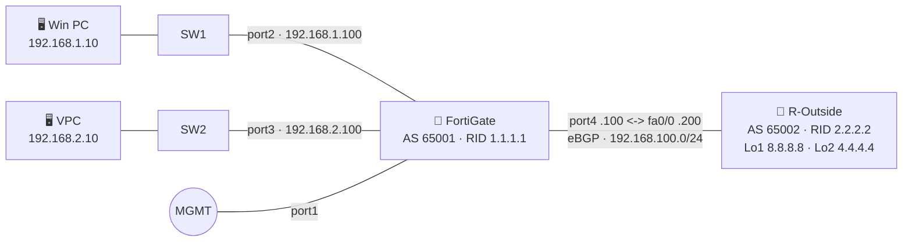

<div align="center">

# 🔥 BGP Configuration on FortiGate + SD-WAN 🌐

### FortiGate Firewall ↔ Cisco Router (R-Outside) — eBGP


  

**Configure • Verify • Troubleshoot • Learn**
</div>

---

## 📑 Quick navigation

1. [🎯 Lab Objective](#-lab-objective)
2. [🗺️ Topology](#️-topology)
3. [📋 IP Addressing Table](#-ip-addressing-table)
4. [⚙️ BGP Parameters](#️-bgp-parameters)
5. [🛡️ FortiGate Configuration](#️-fortigate-configuration)
6. [📡 R-Outside (Cisco) Configuration](#-r-outside-cisco-configuration)
7. [💻 PC Configuration](#-pc-configuration)
8. [✅ Verification](#-verification)
9. [🧰 Troubleshooting](#-troubleshooting)
10. [📚 References](#-references)

---

## 🎯 Lab Objective

- Establish an **eBGP** session between FortiGate `port4` (AS 65001) and Cisco `Fa0/0` (AS 65002).
- Advertise both FortiGate LAN subnets (`192.168.1.0/24`, `192.168.2.0/24`) to Cisco using BGP `network` statements.
- Learn Cisco loopback host routes (`8.8.8.8/32`, `4.4.4.4/32`) on FortiGate through BGP.
- Permit LAN clients to reach the Cisco loopbacks through firewall policies.

> 💡 **Scope:** Pehle working BGP build karo. Multi-WAN SD-WAN ek alag extension hai.

### 🔁 OSPF vs BGP — is lab me kya change hua?

| Point | OSPF lab | BGP lab (ye lab) |
|:---|:---|:---|
| Neighbor discovery | Multicast hello (auto) | Neighbor IP **manually** configure karna padta hai |
| Identity | Router ID + Area 0 | Router ID + **AS number** (local aur remote) |
| Advertise kaise hota hai | `config network` + `ospf-interface` | `config network` (prefix) |
| Transport | IP protocol 89 | **TCP/179** |
| Route type in table | `O` | `B` (eBGP admin distance **20**) |
| Healthy state | `Full` | `Established` |

---

## 🗺️ Topology



> Agar EVE-NG screenshot use karna hai to usse `topology.png` naam se repo me save karo aur yahan `` lagao.

---

## 📋 IP Addressing Table

| 🔧 Device | 🔌 Interface | 🌍 IP Address | 📝 Note |
|:---:|:---:|:---:|:---|
| 🧱 FortiGate | port1 | DHCP / MGMT | Management |
| 🧱 FortiGate | port2 | `192.168.1.100/24` | LAN1 gateway (SW1) |
| 🧱 FortiGate | port3 | `192.168.2.100/24` | LAN2 gateway (SW2) |
| 🧱 FortiGate | port4 | `192.168.100.100/24` | WAN, SD-WAN member (zone `underlay`) |
| 📡 R-Outside | fa0/0 | `192.168.100.200/24` | Link to FortiGate |
| 📡 R-Outside | Loopback1 | `8.8.8.8/32` | Internet simulation |
| 📡 R-Outside | Loopback2 | `4.4.4.4/32` | Internet simulation |
| 🖥️ Win PC | e0 | `192.168.1.10/24` · GW `192.168.1.100` | LAN1 host |
| 🖥️ VPC | eth0 | `192.168.2.10/24` · GW `192.168.2.100` | LAN2 host |

> [!NOTE]
> SW1 aur SW2 simple Layer-2 switches maane gaye hain (default VLAN 1), aur PCs ka gateway FortiGate hai. Diagram me dono loopback "Loopback1" likhe hain, is lab me second loopback ko **Loopback2** use kiya hai.

---

## ⚙️ BGP Parameters

| 🏷️ Parameter | 🧱 FortiGate | 📡 R-Outside |
|:---|:---:|:---:|
| 🆔 Router ID | `1.1.1.1` | `2.2.2.2` |
| 🌐 Local AS | `65001` | `65002` |
| 🤝 Neighbor | `192.168.100.200` (remote-as `65002`) | `192.168.100.100` (remote-as `65001`) |
| 🔗 Session type | eBGP (AS alag hain) | eBGP |
| 📣 Advertised | `192.168.1.0/24`, `192.168.2.0/24` | `8.8.8.8/32`, `4.4.4.4/32` |

> [!NOTE]
> `65001` aur `65002` private AS numbers hain (lab ke liye). Dono routers directly connected hain, isliye eBGP multihop ki zaroorat **nahi** hai. Multihop sirf tab chahiye jab eBGP peer multiple hops door ho.

---

## 🛡️ FortiGate Configuration

### 🔹 Step 1: Interface Configuration

```
config system interface
    edit "port2"
        set mode static
        set ip 192.168.1.100 255.255.255.0
        set allowaccess ping
        set role lan
    next
    edit "port3"
        set mode static
        set ip 192.168.2.100 255.255.255.0
        set allowaccess ping
        set role lan
    next
    edit "port4"
        set mode static
        set ip 192.168.100.100 255.255.255.0
        set allowaccess ping
        set role wan
    next
end
```

### 🔹 Step 2: SD-WAN Configuration 🌐

`port4` ko SD-WAN zone `underlay` ka member banate hain. Health-check `8.8.8.8` (R-Outside ka Loopback1) ko ping karta hai. Ye route BGP se seekha jayega, isliye health-check tabhi up hoga jab BGP session Established ho.

```
config system sdwan
    set status enable
    config zone
        edit "underlay"
        next
    end
    config members
        edit 1
            set interface "port4"
            set zone "underlay"
        next
    end
    config health-check
        edit "HC-8888"
            set server "8.8.8.8"
            set members 1
        next
    end
end
```

> [!IMPORTANT]
> Individual SD-WAN member interface (`port4`) ko firewall policy me directly use nahi kar sakte. Policy me **SD-WAN zone** (`underlay`) use hota hai. Interface ko SD-WAN me add karne se pehle ensure karo ki `port4` kisi existing firewall policy ya static route me reference na ho.

### 🔹 Step 3: BGP Configuration 🔁

```
config router bgp
    set as 65001
    set router-id 1.1.1.1
    config neighbor
        edit "192.168.100.200"
            set remote-as 65002
        next
    end
    config network
        edit 1
            set prefix 192.168.1.0 255.255.255.0
        next
        edit 2
            set prefix 192.168.2.0 255.255.255.0
        next
    end
end
```

> [!TIP]
> BGP me `192.168.100.0/24` advertise karne ki zaroorat nahi hai, kyunki dono devices us subnet par directly connected hain. `network` statement wala prefix FortiGate ke routing table me hona chahiye (yahan `port2`/`port3` connected routes hain), tabhi wo BGP table me aata hai.

### 🔹 Step 4: Firewall Policy 🔒

Destination me SD-WAN **zone** use hoga. NAT disable hai kyunki R-Outside ko LAN routes BGP se mil jaate hain.

```
config firewall policy
    edit 1
        set name "LAN-to-SDWAN"
        set srcintf "port2" "port3"
        set dstintf "underlay"
        set srcaddr "all"
        set dstaddr "all"
        set action accept
        set schedule "always"
        set service "ALL"
        set nat disable
    next
    edit 2
        set name "LAN1-LAN2"
        set srcintf "port2" "port3"
        set dstintf "port2" "port3"
        set srcaddr "all"
        set dstaddr "all"
        set action accept
        set schedule "always"
        set service "ALL"
    next
end
```

**Optional (sirf tab jab R-Outside se LAN PCs ko ping karna ho, jaise `ping 192.168.1.10 source Loopback1`):**

```
config firewall policy
    edit 3
        set name "SDWAN-to-LAN"
        set srcintf "underlay"
        set dstintf "port2" "port3"
        set srcaddr "all"
        set dstaddr "all"
        set action accept
        set schedule "always"
        set service "PING"
    next
end
```

> [!NOTE]
> BGP session (TCP/179) FortiGate ke apne local traffic hai, isliye session banane ke liye alag firewall policy nahi chahiye. Logging chahiye ho to policy me `set logtraffic all` add kar sakte ho.

---

## 📡 R-Outside (Cisco) Configuration

```
enable
configure terminal
hostname R-Outside
!
interface FastEthernet0/0
 ip address 192.168.100.200 255.255.255.0
 no shutdown
!
interface Loopback1
 ip address 8.8.8.8 255.255.255.255
!
interface Loopback2
 ip address 4.4.4.4 255.255.255.255
!
router bgp 65002
 bgp router-id 2.2.2.2
 bgp log-neighbor-changes
 neighbor 192.168.100.100 remote-as 65001
 network 8.8.8.8 mask 255.255.255.255
 network 4.4.4.4 mask 255.255.255.255
!
end
write memory
```

---

## 💻 PC Configuration

**🖥️ Win PC:** IP `192.168.1.10` · Mask `255.255.255.0` · Gateway `192.168.1.100`

**🖥️ VPC (EVE-NG / GNS3):**

```
ip 192.168.2.10/24 192.168.2.100
save
```

---

## ✅ Verification

### 🧱 On FortiGate

```
get router info bgp summary
get router info bgp neighbors
get router info bgp network
get router info routing-table bgp
get router info routing-table all
diagnose sys sdwan health-check
diagnose sys sdwan member
execute ping-options source 192.168.100.100
execute ping 192.168.100.200
execute ping 8.8.8.8
execute ping 4.4.4.4
```

✔️ Expected:

- Neighbor `192.168.100.200` ka state **Established**.
- `get router info bgp network` me `8.8.8.8/32` aur `4.4.4.4/32` next hop `192.168.100.200` ke saath.
- Routing table me `B 8.8.8.8/32 [20/0] via 192.168.100.200, port4` aur `B 4.4.4.4/32 [20/0] via 192.168.100.200, port4`.

### 📡 On R-Outside (Cisco)

```
show ip bgp summary
show ip bgp
show ip route bgp
show ip interface brief
ping 192.168.100.100
ping 192.168.1.100 source FastEthernet0/0
ping 192.168.2.100 source FastEthernet0/0
```

Optional (policy 3 lagne ke baad):

```
ping 192.168.1.10 source Loopback1
ping 192.168.2.10 source Loopback1
```

✔️ Expected: neighbor `192.168.100.100` **Established** (summary me prefix count dikhta hai, state nahi), aur routes `B 192.168.1.0/24`, `B 192.168.2.0/24` via `192.168.100.100`.

### 💻 Client testing

```powershell
# Windows
ping 192.168.1.100
ping 8.8.8.8
ping 4.4.4.4
tracert 8.8.8.8
```

```text
# VPCS
ping 192.168.2.100
ping 8.8.8.8
ping 4.4.4.4
trace 8.8.8.8
```

### 🚀 End-to-End Test

| 🖥️ Source | 🎯 Destination | 📶 Expected |
|:---:|:---:|:---:|
| Win PC | `8.8.8.8` | ✅ Reply |
| Win PC | `4.4.4.4` | ✅ Reply |
| VPC | `8.8.8.8` | ✅ Reply |
| VPC | `4.4.4.4` | ✅ Reply |
| Win PC | `192.168.2.10` (VPC) | ✅ Reply (Windows Firewall ICMP allow ho to) |

### 🔬 Extra diagnostics (FortiGate)

```
get router info bgp neighbors 192.168.100.200
diagnose sniffer packet any 'tcp and port 179'
execute router clear bgp all
```

> `execute router clear bgp all` se session reset hota hai (lab me config change ke baad useful). Sniffer ka output dekhne ke baad `Ctrl+C` se band karo. Production firewall par reset/debug maintenance window me hi karo.

## 🧭 Expected routing path

```text
Windows 192.168.1.10
    -> FortiGate port2 192.168.1.100
    -> FortiGate port4 192.168.100.100   (route learned via BGP)
    -> Cisco Fa0/0 192.168.100.200
    -> Cisco Loopback1 8.8.8.8   |   Cisco Loopback2 4.4.4.4

VPC 192.168.2.10
    -> FortiGate port3 192.168.2.100
    -> FortiGate port4 192.168.100.100   (route learned via BGP)
    -> Cisco Fa0/0 192.168.100.200
    -> Cisco Loopback1 8.8.8.8   |   Cisco Loopback2 4.4.4.4
```

---

## 🧰 Troubleshooting

### BGP state kya batata hai

| State | Matlab |
|:---|:---|
| **Idle** | Local FortiGate ne neighbor ke saath BGP process start nahi kiya. eBGP peer multiple hops door ho aur multihop enable na ho to bhi aisa ho sakta hai |
| **Connect** | BGP process start ho gaya, par TCP connection initiate nahi hua (aksar routing issue) |
| **Active** | TCP connection initiate hua par peer se response nahi aaya (delivery ya remote side ka issue) |
| **Established** | Session up hai, routes exchange ho rahe hain ✅ |

### Common problems

| ❌ Problem | 🔍 Check |
|:---|:---|
| Neighbor Established nahi ho raha | Dono side neighbor IP, `remote-as` aur local AS match karo. eBGP me local AS aur remote AS **alag** hone chahiye |
| Idle / Connect / Active me atka hai | `ping 192.168.100.200` karo, phir `diagnose sniffer packet any 'tcp and port 179'` se TCP/179 check karo |
| Session up hai par route nahi aa raha | Cisco par `network` mask exact match hona chahiye aur loopback up/up hona chahiye (route RIB me ho). FortiGate par `get router info bgp network` dekho |
| Cisco ko LAN routes nahi mil rahe | FortiGate `config network` me `192.168.1.0/24` aur `192.168.2.0/24` hain ya nahi, aur `port2`/`port3` up hain ya nahi check karo |
| `port4` SD-WAN me add nahi ho raha | Interface kisi firewall policy / static route / DHCP server me reference ho raha hoga |
| BGP route aa raha hai par ping fail | Firewall policy me `dstintf` SD-WAN zone `underlay` hai ya nahi dekho |
| R-Outside se LAN PC ping fail | Reverse direction (underlay → LAN) ki policy chahiye (Optional policy 3) |
| SD-WAN health-check down | `get router info routing-table bgp` me `8.8.8.8/32` route hai ya nahi dekho |
| Config change ke baad purane routes | `execute router clear bgp all` chalao |

> [!NOTE]
> BGP default timers slow hote hain (output me hold time 180s, keepalive 60s dikhta hai), isliye neighbor down hone par convergence OSPF se dheema ho sakta hai. Lab me thoda wait karo.

---

## 📚 References

- 📘 [FortiOS Administration Guide: Basic BGP example](https://docs.fortinet.com/document/fortigate/8.0.2/administration-guide/763341/basic-bgp-example)
- 📗 [FortiOS Administration Guide: SD-WAN members and zones](https://docs.fortinet.com/document/fortigate/8.0.2/administration-guide/942095/sd-wan-members-and-zones)
- 📙 [FortiGate Documentation Library](https://docs.fortinet.com/product/fortigate)

---

<div align="center">

⭐ **Agar ye lab helpful laga to repo ko star kar dena!** ⭐

Made with ❤️ for Network Engineers

</div>
