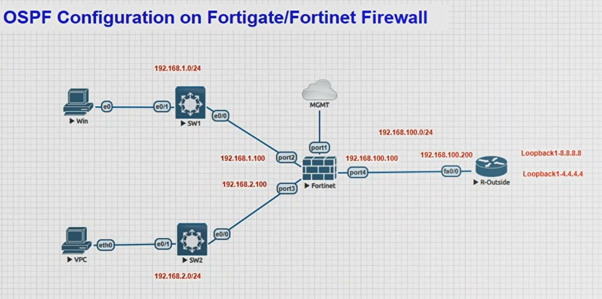
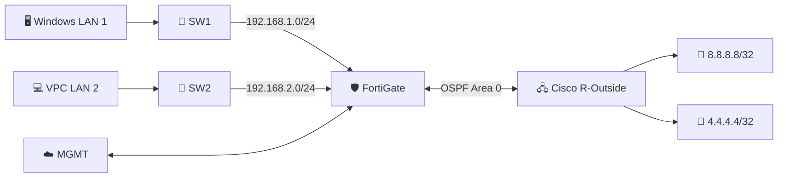

<div align="center">

# 🛡️ FortiGate Firewall × Cisco Router
### 🌐 OSPF Area 0 — Hands-on Networking Lab

  

  

**Configure • Verify • Troubleshoot • Learn**

</div>

---

## 📸 Lab topology

> Step-by-step FortiGate + Cisco IOS OSPF Area 0 lab. Suitable for EVE-NG/GNS3. Commands assume FortiOS 7.x and Cisco IOS; check interface names and platform syntax before applying.

<div align="center">



*Actual lab topology: 2 LANs → FortiGate → Cisco R-Outside → 2 loopbacks*

</div>

> [!IMPORTANT]
> **Topology clarification:** This diagram shows **one outside link**. It is an **OSPF lab**, not a multi-WAN SD-WAN failover demonstration. Both loopbacks are labeled `Loopback1` in the image; the commands use `Loopback0` and `Loopback1`.

## 🧭 Quick navigation

- [🎯 Lab objectives](#-1-lab-objective)
- [📋 IP addressing](#-2-ip-addressing)
- [🔌 FortiGate interfaces](#-3-fortigate-interface-configuration)
- [🖧 Cisco router](#-4-cisco-r-outside-configuration)
- [🔁 FortiGate OSPF](#-5-fortigate-ospf-configuration)
- [🔐 Firewall policies](#-6-fortigate-firewall-policy-lan-to-cisco-loopbacks)
- [💻 Client setup](#-7-client-setup)
- [✅ Verification](#-8-verification)
- [🧰 Troubleshooting](#-9-troubleshooting)
- [🛣️ Traffic flow](#-10-expected-routing-path)

### 🧩 How the lab works


<!-- ["🛡️ FortiGate <br>port2: 192.168.1.100<br/>port3: 192.168.2.100<br/>port4: 192.168.100.100"] -->

## 🎯 1. Lab objective

- Establish OSPF adjacency between FortiGate `port4` and Cisco `Fa0/0`.
- Advertise both FortiGate LAN subnets to Cisco.
- Learn Cisco loopback host routes on FortiGate.
- Permit LAN clients to reach the Cisco loopbacks through firewall policies.

> 💡 **Scope:** Build working OSPF first. Multi-WAN SD-WAN is a separate extension.

## 📋 2. IP addressing

| Node | Interface | IPv4 address | Description |
|---|---|---|---|
| FortiGate | port1 | DHCP / lab-specific | Management; excluded from OSPF |
| FortiGate | port2 | 192.168.1.100/24 | LAN 1 |
| FortiGate | port3 | 192.168.2.100/24 | LAN 2 |
| FortiGate | port4 | 192.168.100.100/24 | OSPF transit |
| Cisco R-Outside | FastEthernet0/0 | 192.168.100.200/24 | OSPF transit |
| Cisco R-Outside | Loopback0 | 8.8.8.8/32 | Test destination |
| Cisco R-Outside | Loopback1 | 4.4.4.4/32 | Test destination |
| Windows client | Ethernet | 192.168.1.10/24 | Gateway 192.168.1.100 (example) |
| VPC client | eth0 | 192.168.2.10/24 | Gateway 192.168.2.100 (example) |

The client addresses are suggested examples; the diagram does not specify them. **8.8.8.8 and 4.4.4.4 are public DNS IPs in the real world**; here they are simulated router loopbacks only. Do not advertise or route these public IPs outside an isolated lab.

## 🔌 3. FortiGate interface configuration

Run these commands from the FortiGate CLI (adjust administrative access to your security requirements).

```fortios
config system interface
    edit "port2"
        set mode static
        set ip 192.168.1.100 255.255.255.0
        set allowaccess ping
    next
    edit "port3"
        set mode static
        set ip 192.168.2.100 255.255.255.0
        set allowaccess ping
    next
    edit "port4"
        set mode static
        set ip 192.168.100.100 255.255.255.0
        set allowaccess ping
    next
end
```

> If an interface is already assigned to a switch, zone, or SD-WAN, do not blindly paste these commands. Check its existing membership and dependencies first.

## 🖧 4. Cisco R-Outside configuration

```cisco
configure terminal
hostname R-Outside
!
interface FastEthernet0/0
 description OSPF_TRANSIT_TO_FORTIGATE_PORT4
 ip address 192.168.100.200 255.255.255.0
 no shutdown
exit
!
interface Loopback0
 description LAB_LOOPBACK_8_8_8_8
 ip address 8.8.8.8 255.255.255.255
exit
!
interface Loopback1
 description LAB_LOOPBACK_4_4_4_4
 ip address 4.4.4.4 255.255.255.255
exit
!
router ospf 1
 router-id 2.2.2.2
 passive-interface default
 no passive-interface FastEthernet0/0
 network 192.168.100.0 0.0.0.255 area 0
 network 8.8.8.8 0.0.0.0 area 0
 network 4.4.4.4 0.0.0.0 area 0
exit
end
write memory
```

## 🔁 5. FortiGate OSPF configuration

FortiOS OSPF `network` entries select the interfaces participating in OSPF. Make LAN interfaces passive to advertise their connected networks without sending OSPF Hellos on the client-facing links.

```fortios
config router ospf
    set router-id 1.1.1.1
    config area
        edit 0.0.0.0
        next
    end
    config network
        edit 1
            set prefix 192.168.100.0 255.255.255.0
            set area 0.0.0.0
        next
        edit 2
            set prefix 192.168.1.0 255.255.255.0
            set area 0.0.0.0
        next
        edit 3
            set prefix 192.168.2.0 255.255.255.0
            set area 0.0.0.0
        next
    end
    config ospf-interface
        edit "OSPF-TRANSIT"
            set interface "port4"
            set network-type broadcast
        next
        edit "OSPF-LAN1"
            set interface "port2"
            set passive-interface enable
        next
        edit "OSPF-LAN2"
            set interface "port3"
            set passive-interface enable
        next
    end
end
```

> FortiOS CLI availability and syntax can vary by release. Confirm the `passive-interface` setting with `set ?` under `config router ospf -> config ospf-interface` if your version differs. For FortiOS configurations that require a separate `config passive-interface` section, use the version-specific equivalent.

## 🔐 6. FortiGate firewall policy (LAN to Cisco loopbacks)

For this lab, allow traffic from both LANs to the transit-facing `port4` without source NAT. OSPF supplies the return routes to the Cisco router.

```fortios
config firewall policy
    edit 0
        set name "LAN1-to-OSPF-Lab"
        set srcintf "port2"
        set dstintf "port4"
        set srcaddr "all"
        set dstaddr "all"
        set action accept
        set schedule "always"
        set service "PING"
        set nat disable
        set logtraffic all
    next
    edit 0
        set name "LAN2-to-OSPF-Lab"
        set srcintf "port3"
        set dstintf "port4"
        set srcaddr "all"
        set dstaddr "all"
        set action accept
        set schedule "always"
        set service "PING"
        set nat disable
        set logtraffic all
    next
end
```

These intentionally narrow ICMP policies are for testing. If broader access is needed, add only the required services and destinations. OSPF router-to-router control traffic is not enabled by an ordinary transit firewall policy; OSPF runs on the FortiGate interface itself.

## 💻 7. Client setup

**Windows client (example):** Configure IPv4 `192.168.1.10`, mask `255.255.255.0`, default gateway `192.168.1.100`.

**VPC (EVE-NG/GNS3 VPCS):**

```text
ip 192.168.2.10/24 192.168.2.100
save
```

Ensure the L2 switches connect to the intended FortiGate ports. Switch configuration is not required for basic untagged access ports.

## ✅ 8. Verification

### FortiGate

```fortios
get router info ospf neighbor
get router info ospf interface
get router info routing-table ospf
get router info routing-table all
execute ping-options source 192.168.100.100
execute ping 192.168.100.200
execute ping 8.8.8.8
execute ping 4.4.4.4
```

Expected: Cisco neighbor `2.2.2.2` reaches **Full** state; FortiGate learns OSPF routes to `8.8.8.8/32` and `4.4.4.4/32` via `192.168.100.200`.

### Cisco

```cisco
show ip ospf neighbor
show ip ospf interface brief
show ip route ospf
show ip protocols
show ip interface brief
ping 192.168.100.100
ping 192.168.1.100 source FastEthernet0/0
ping 192.168.2.100 source FastEthernet0/0
```

Expected: FortiGate neighbor `1.1.1.1` reaches **FULL** state; Cisco learns `192.168.1.0/24` and `192.168.2.0/24` through `192.168.100.100`.

### Client testing

```powershell
# Windows
ping 192.168.1.100
ping 8.8.8.8
ping 4.4.4.4
tracert 8.8.8.8
```

```text
# VPCS
ping 192.168.2.100
ping 8.8.8.8
ping 4.4.4.4
trace 8.8.8.8
```

## 🧰 9. Troubleshooting

| Problem | What to check |
|---|---|
| OSPF neighbor absent | Link/interface status, subnet/mask, OSPF area, OSPF enabled on port4/Fa0/0, Hello/Dead timers, ACLs/local-in policies |
| Neighbor stuck in EXSTART/EXCHANGE | MTU mismatch and OSPF network type |
| Neighbor FULL but routes missing | OSPF network statements, passive LAN interfaces, connected routes, route filters |
| Routes present but clients cannot ping | Client gateway, FortiGate policy, NAT disabled, return route, host firewall |
| Loopback ping works from FortiGate but not from clients | Verify LAN-to-port4 policy, Cisco OSPF LAN routes and client source IP |

FortiGate additional diagnostics:

```fortios
diagnose ip router ospf all enable
get router info ospf database
```

> Diagnostic commands vary by FortiOS release; use the supported `diagnose ip router ospf ?` options and disable debugging after use. Avoid enabling verbose debugging on production firewalls without a maintenance plan.

## 🛣️ 10. Expected routing path

```text
Windows 192.168.1.10
    -> FortiGate port2 192.168.1.100
    -> FortiGate port4 192.168.100.100
    -> Cisco Fa0/0 192.168.100.200
    -> Cisco Loopback0 8.8.8.8

VPC 192.168.2.10
    -> FortiGate port3 192.168.2.100
    -> FortiGate port4 192.168.100.100
    -> Cisco Fa0/0 192.168.100.200
    -> Cisco Loopback1 4.4.4.4
```

## 🚀 11. Notes and next steps

- This topology has **one** outside interface, so it does not demonstrate SD-WAN failover.
- To extend it to SD-WAN, add a second upstream link and design route selection, health checks, and OSPF adjacency appropriately.
- These are lab commands, not a production hardening baseline.
- Tested output screenshots should be added after running the lab; expected results above are not claimed as observed.

---

<div align="center">

### ⭐ Enjoyed this lab?
**Star the repository • Fork it • Practice it in your own EVE-NG lab**

*Made for network engineers and learners 🧑‍💻*

</div>

## 📄 License

Lab documentation for educational use. Add your preferred repository license if you plan to redistribute it.
