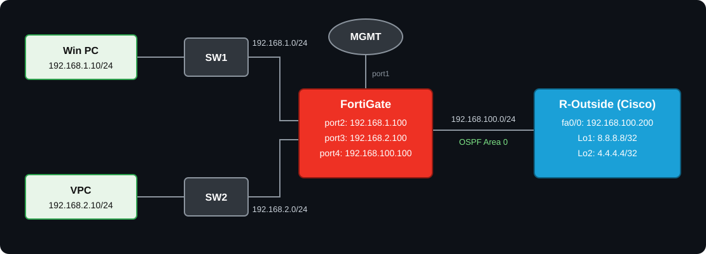

<div align="center">

# 🔥 OSPF Configuration on FortiGate + SD-WAN 🌐

### FortiGate Firewall ↔ Cisco Router (R-Outside)


</div>

---

## 📑 Table of Contents

1. [🗺️ Topology](#️-topology)
2. [📋 IP Addressing Table](#-ip-addressing-table)
3. [⚙️ OSPF Parameters](#️-ospf-parameters)
4. [🛡️ FortiGate Configuration](#️-fortigate-configuration)
5. [📡 R-Outside (Cisco) Configuration](#-r-outside-cisco-configuration)
6. [💻 PC Configuration](#-pc-configuration)
7. [✅ Verification](#-verification)
8. [🧰 Troubleshooting](#-troubleshooting)
9. [📚 References](#-references)

---

## 🎯 Lab Objective

FortiGate aur Cisco router (**R-Outside**) ke beech **OSPF Area 0** neighbor banana. FortiGate ka WAN interface (`port4`) **SD-WAN member** hai, aur dono LAN subnets OSPF me advertise hote hain. R-Outside ke loopbacks (`8.8.8.8`, `4.4.4.4`) internet simulate karte hain.

---

## 🗺️ Topology

<div align="center">



</div>

---

## 📋 IP Addressing Table

| 🔧 Device | 🔌 Interface | 🌍 IP Address | 📝 Note |
|:---:|:---:|:---:|:---|
| 🧱 FortiGate | port1 | DHCP / MGMT | Management |
| 🧱 FortiGate | port2 | `192.168.1.100/24` | LAN1 gateway (SW1) |
| 🧱 FortiGate | port3 | `192.168.2.100/24` | LAN2 gateway (SW2) |
| 🧱 FortiGate | port4 | `192.168.100.100/24` | WAN, SD-WAN member (zone `underlay`) |
| 📡 R-Outside | fa0/0 | `192.168.100.200/24` | Link to FortiGate |
| 📡 R-Outside | Loopback1 | `8.8.8.8/32` | Internet simulation |
| 📡 R-Outside | Loopback2 | `4.4.4.4/32` | Internet simulation |
| 🖥️ Win PC | e0 | `192.168.1.10/24` · GW `192.168.1.100` | LAN1 host |
| 🖥️ VPC | eth0 | `192.168.2.10/24` · GW `192.168.2.100` | LAN2 host |

> [!NOTE]
> SW1 aur SW2 simple Layer-2 switches maane gaye hain (default VLAN 1), aur PCs ka gateway FortiGate hai. Diagram me dono loopback "Loopback1" likhe hain, is lab me second loopback ko **Loopback2** use kiya hai.

---

## ⚙️ OSPF Parameters

| 🏷️ Parameter | 🧱 FortiGate | 📡 R-Outside |
|:---|:---:|:---:|
| 🆔 Router ID | `1.1.1.1` | `2.2.2.2` |
| 🧩 Area | `0` (0.0.0.0) | `0` |
| 🔗 Network type | Broadcast | Broadcast |
| 📣 Advertised | `192.168.1.0/24`, `192.168.2.0/24`, `192.168.100.0/24` | `192.168.100.0/24`, `8.8.8.8/32`, `4.4.4.4/32` |

---

## 🛡️ FortiGate Configuration

### 🔹 Step 1: Interface Configuration

```
config system interface
    edit "port2"
        set mode static
        set ip 192.168.1.100 255.255.255.0
        set allowaccess ping
        set role lan
    next
    edit "port3"
        set mode static
        set ip 192.168.2.100 255.255.255.0
        set allowaccess ping
        set role lan
    next
    edit "port4"
        set mode static
        set ip 192.168.100.100 255.255.255.0
        set allowaccess ping
        set role wan
    next
end
```

### 🔹 Step 2: SD-WAN Configuration 🌐

`port4` ko SD-WAN zone `underlay` ka member banate hain. Health-check `8.8.8.8` (R-Outside ka Loopback1) ko ping karta hai.

```
config system sdwan
    set status enable
    config zone
        edit "underlay"
        next
    end
    config members
        edit 1
            set interface "port4"
            set zone "underlay"
        next
    end
    config health-check
        edit "HC-8888"
            set server "8.8.8.8"
            set members 1
        next
    end
end
```

> [!IMPORTANT]
> SD-WAN member interface (`port4`) ko firewall policy me directly use nahi kar sakte. Policy me **SD-WAN zone** (`underlay`) use hota hai. Interface ko SD-WAN me add karne se pehle ensure karo ki `port4` kisi existing firewall policy ya static route me reference na ho.

### 🔹 Step 3: OSPF Configuration 🔁

```
config router ospf
    set router-id 1.1.1.1
    set passive-interface "port2" "port3"
    config area
        edit 0.0.0.0
        next
    end
    config network
        edit 1
            set prefix 192.168.100.0 255.255.255.0
            set area 0.0.0.0
        next
        edit 2
            set prefix 192.168.1.0 255.255.255.0
            set area 0.0.0.0
        next
        edit 3
            set prefix 192.168.2.0 255.255.255.0
            set area 0.0.0.0
        next
    end
    config ospf-interface
        edit "OSPF-port4"
            set interface "port4"
            set network-type broadcast
        next
    end
end
```

> [!TIP]
> `passive-interface` se LAN side (`port2`, `port3`) par OSPF hello nahi jaata, lekin un subnets ka advertisement `config network` ki wajah se hota rehta hai.

### 🔹 Step 4: Firewall Policy 🔒

Destination me SD-WAN **zone** use hoga. NAT disable hai kyunki R-Outside ko LAN routes OSPF se mil jaate hain.

```
config firewall policy
    edit 1
        set name "LAN-to-SDWAN"
        set srcintf "port2" "port3"
        set dstintf "underlay"
        set srcaddr "all"
        set dstaddr "all"
        set action accept
        set schedule "always"
        set service "ALL"
        set nat disable
    next
    edit 2
        set name "LAN1-LAN2"
        set srcintf "port2" "port3"
        set dstintf "port2" "port3"
        set srcaddr "all"
        set dstaddr "all"
        set action accept
        set schedule "always"
        set service "ALL"
    next
end
```

> [!NOTE]
> OSPF hello/DBD packets FortiGate ke local traffic hain, inke liye alag firewall policy ki zaroorat nahi hoti.

---

## 📡 R-Outside (Cisco) Configuration

```
enable
configure terminal
hostname R-Outside
!
interface FastEthernet0/0
 ip address 192.168.100.200 255.255.255.0
 no shutdown
!
interface Loopback1
 ip address 8.8.8.8 255.255.255.255
!
interface Loopback2
 ip address 4.4.4.4 255.255.255.255
!
router ospf 1
 router-id 2.2.2.2
 network 192.168.100.0 0.0.0.255 area 0
 network 8.8.8.8 0.0.0.0 area 0
 network 4.4.4.4 0.0.0.0 area 0
!
end
write memory
```

---

## 💻 PC Configuration

**🖥️ Win PC:** IP `192.168.1.10` · Mask `255.255.255.0` · Gateway `192.168.1.100`

**🖥️ VPC (EVE-NG / GNS3):**

```
ip 192.168.2.10/24 192.168.2.100
save
```

---

## ✅ Verification

### 🧱 On FortiGate

```
get router info ospf neighbor
get router info ospf interface
get router info ospf status
get router info routing-table ospf
get router info routing-table all
diagnose sys sdwan health-check
diagnose sys sdwan member
execute ping 8.8.8.8
execute ping 4.4.4.4
```

✔️ Expected: neighbor `2.2.2.2` state **Full**, aur routing table me `O 8.8.8.8/32` aur `O 4.4.4.4/32` via `192.168.100.200, port4`.

### 📡 On R-Outside (Cisco)

```
show ip ospf neighbor
show ip ospf interface brief
show ip route ospf
ping 192.168.1.10 source Loopback1
ping 192.168.2.10 source Loopback1
```

✔️ Expected: neighbor `1.1.1.1` state **FULL/DR** ya **FULL/BDR**, aur routes `O 192.168.1.0/24`, `O 192.168.2.0/24`.

### 🚀 End-to-End Test

| 🖥️ Source | 🎯 Destination | 📶 Expected |
|:---:|:---:|:---:|
| Win PC | `8.8.8.8` | ✅ Reply |
| Win PC | `4.4.4.4` | ✅ Reply |
| VPC | `8.8.8.8` | ✅ Reply |
| Win PC | `192.168.2.10` (VPC) | ✅ Reply |

---

## 🧰 Troubleshooting

| ❌ Problem | 🔍 Check |
|:---|:---|
| Neighbor Full nahi ho raha | Dono side area ID, subnet mask, hello/dead timers aur network type match karo |
| Neighbor ExStart / 2-Way me atka hai | MTU mismatch check karo; broadcast network me DR/BDR election ki wajah se 2-Way normal ho sakta hai |
| `port4` SD-WAN me add nahi ho raha | Interface kisi firewall policy / static route / DHCP server me reference ho raha hoga |
| OSPF route aa raha hai par ping fail | Firewall policy me `dstintf` SD-WAN zone `underlay` hai ya nahi check karo |
| SD-WAN health-check down | `get router info routing-table ospf` me `8.8.8.8/32` route hai ya nahi dekho |

---

## 📚 References

- 📘 [FortiOS Administration Guide: Basic OSPF example](https://docs.fortinet.com/document/fortigate/7.0.13/administration-guide/358640)
- 📗 [FortiOS CLI Reference: config router ospf](https://docs.fortinet.com/document/fortigate/6.4.13/cli-reference/553620)
- 📙 [FortiOS Administration Guide: SD-WAN members and zones](https://docs.fortinet.com/document/fortigate/7.2.3/administration-guide/942095)

---

<div align="center">

⭐ **Agar ye lab helpful laga to repo ko star kar dena!** ⭐

Made with ❤️ for Network Engineers

</div>
