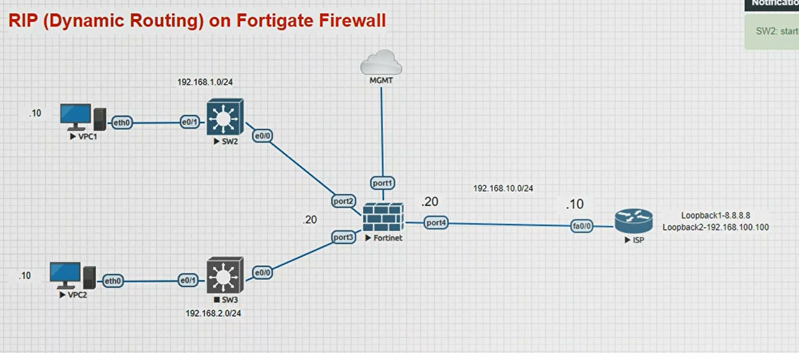
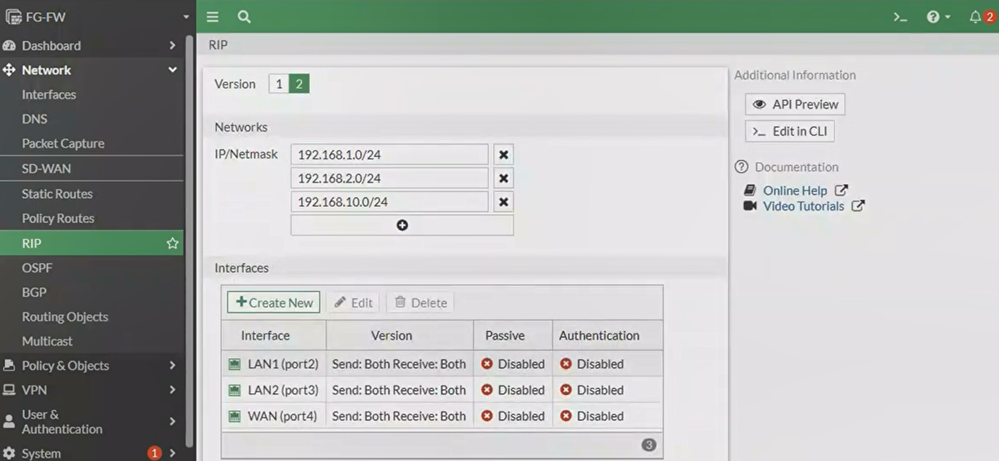

## 🦄 Routing - RIP in Fortigate Firewall 

### Topology Diagram



### Cisco Router (ISP) Configuration:

#### 1. Check Hostname :

```
config t
hostname ISP
```
#### 2. Configure Interface f0/0 :

```
interface f0/0
ip address 192.168.10.10 255.255.255.0
no shut
```
#### 2. Configure Loopback interface :

```
interface lo1
ip address 8.8.8.8 255.255.255.0
```
```
interface lo2
ip address 192.168.100.100 255.255.255.0
```
>[!NOTE]
>Loopback we can also provide subnet 255.255.255.255 or /32

### RIP Configuration Cisco end :

```
router rip
version 2
network 192.168.10.0
network 8.8.8.8
no auto-summary
wr
```


### Fortigate Firewall Configuration:

#### Check Fortigate Interface :

```
show system interface ?
```
### RIP Configuration Fortigate end :
