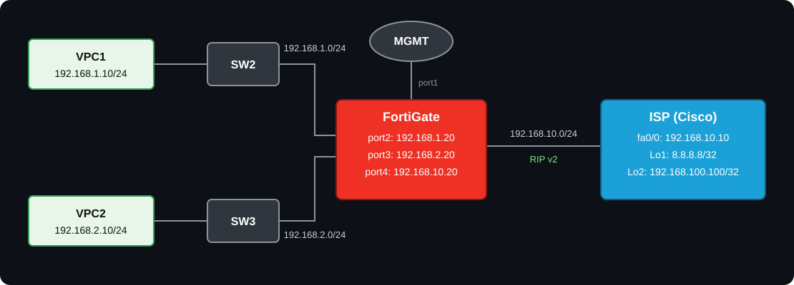

<div align="center">

# 🔥 RIP (Dynamic Routing) on FortiGate + SD-WAN 🌐

### FortiGate Firewall ↔ Cisco Router (ISP)


  

**Configure • Verify • Troubleshoot • Learn**
</div>

---

## 📑 Quick navigation

1. [🎯 Lab Objective](#-lab-objective)
2. [🗺️ Topology](#️-topology)
3. [📋 IP Addressing Table](#-ip-addressing-table)
4. [⚙️ RIP Parameters](#️-rip-parameters)
5. [🛡️ FortiGate Configuration](#️-fortigate-configuration)
6. [📡 ISP (Cisco) Configuration](#-isp-cisco-configuration)
7. [💻 PC Configuration](#-pc-configuration)
8. [✅ Verification](#-verification)
9. [🧰 Troubleshooting](#-troubleshooting)
10. [📚 References](#-references)

---

## 🎯 Lab Objective

FortiGate aur Cisco router (**ISP**) ke beech **RIP version 2** chalana. FortiGate ka WAN interface (`port4`) **SD-WAN member** hai, aur dono LAN subnets RIP se ISP ko advertise hote hain. ISP ke loopbacks (`8.8.8.8`, `192.168.100.100`) internet simulate karte hain.

---

## 🗺️ Topology

<div align="center">



</div>

---

## 📋 IP Addressing Table

| 🔧 Device | 🔌 Interface | 🌍 IP Address | 📝 Note |
|:---:|:---:|:---:|:---|
| 🧱 FortiGate | port1 | DHCP / MGMT | Management |
| 🧱 FortiGate | port2 | `192.168.1.20/24` | LAN1 gateway (SW2) |
| 🧱 FortiGate | port3 | `192.168.2.20/24` | LAN2 gateway (SW3) |
| 🧱 FortiGate | port4 | `192.168.10.20/24` | WAN, SD-WAN member (zone `underlay`) |
| 📡 ISP | fa0/0 | `192.168.10.10/24` | Link to FortiGate |
| 📡 ISP | Loopback1 | `8.8.8.8/32` | Internet simulation |
| 📡 ISP | Loopback2 | `192.168.100.100/32` | Internet simulation |
| 🖥️ VPC1 | eth0 | `192.168.1.10/24` · GW `192.168.1.20` | LAN1 host |
| 🖥️ VPC2 | eth0 | `192.168.2.10/24` · GW `192.168.2.20` | LAN2 host |

> [!NOTE]
> SW2 aur SW3 simple Layer-2 switches maane gaye hain (default VLAN 1), aur VPCs ka gateway FortiGate hai. Diagram me `.10` / `.20` last octet dikhaye gaye hain, isliye poore IP unhi subnets se banaye hain. Loopback2 ka mask diagram me nahi hai, is lab me `/32` liya hai.

---

## ⚙️ RIP Parameters

| 🏷️ Parameter | 🧱 FortiGate | 📡 ISP |
|:---|:---:|:---:|
| 🔢 RIP Version | `2` | `2` |
| 🔗 Active interface | `port4` | `fa0/0` |
| 📣 Advertised | `192.168.1.0/24`, `192.168.2.0/24`, `192.168.10.0/24` | `192.168.10.0/24`, `8.8.8.8/32`, `192.168.100.100/32` |
| 📏 Admin Distance | 120 (default) | 120 (default) |

> [!IMPORTANT]
> RIP me `network` statement **classful** hota hai. FortiGate par `config network` me `prefix` classful network (is lab me /24 subnets, jo Class C hain) dena hota hai. Cisco par `network 8.0.0.0` likhne se `8.8.8.8` loopback RIP me aata hai.

---

## 🛡️ FortiGate Configuration

### 🔹 Step 1: Interface Configuration

```
config system interface
    edit "port2"
        set mode static
        set ip 192.168.1.20 255.255.255.0
        set allowaccess ping
        set role lan
    next
    edit "port3"
        set mode static
        set ip 192.168.2.20 255.255.255.0
        set allowaccess ping
        set role lan
    next
    edit "port4"
        set mode static
        set ip 192.168.10.20 255.255.255.0
        set allowaccess ping
        set role wan
    next
end
```

### 🔹 Step 2: SD-WAN Configuration 🌐

`port4` ko SD-WAN zone `underlay` ka member banate hain. Health-check `8.8.8.8` (ISP ka Loopback1) ko ping karta hai.

```
config system sdwan
    set status enable
    config zone
        edit "underlay"
        next
    end
    config members
        edit 1
            set interface "port4"
            set zone "underlay"
        next
    end
    config health-check
        edit "HC-8888"
            set server "8.8.8.8"
            set members 1
        next
    end
end
```

> [!IMPORTANT]
> SD-WAN member interface (`port4`) ko firewall policy me directly use nahi kar sakte. Policy me **SD-WAN zone** (`underlay`) use hota hai. Interface ko SD-WAN me add karne se pehle ensure karo ki `port4` kisi existing firewall policy ya static route me reference na ho.

> [!TIP]
> Agar sirf RIP seekhna hai aur SD-WAN nahi chahiye, to Step 2 skip karo, aur Step 4 me `dstintf "underlay"` ki jagah `dstintf "port4"` likho.

### 🔹 Step 3: RIP Configuration 🔁

```
config router rip
    set version 2
    config network
        edit 1
            set prefix 192.168.10.0 255.255.255.0
        next
        edit 2
            set prefix 192.168.1.0 255.255.255.0
        next
        edit 3
            set prefix 192.168.2.0 255.255.255.0
        next
    end
    config interface
        edit "port4"
            set receive-version 2
            set send-version 2
        next
    end
end
```

> [!TIP]
> LAN side (`port2`, `port3`) par RIP updates band karne ke liye `passive-interface` use hota hai, lekin iska syntax FortiOS version ke hisaab se alag hai (purane version me `config passive-interface` + `set name`, kuch versions me `set passive-interface "port2" "port3"`). Apne version par `config router rip` ke andar `?` lagakar check karo. Lab me ye zaroori nahi hai, bina passive ke bhi sab chalega.

### 🔹 Step 4: Firewall Policy 🔒

Destination me SD-WAN **zone** use hoga. NAT disable hai kyunki ISP ko LAN routes RIP se mil jaate hain.

```
config firewall policy
    edit 1
        set name "LAN-to-SDWAN"
        set srcintf "port2" "port3"
        set dstintf "underlay"
        set srcaddr "all"
        set dstaddr "all"
        set action accept
        set schedule "always"
        set service "ALL"
        set nat disable
    next
    edit 2
        set name "LAN1-LAN2"
        set srcintf "port2" "port3"
        set dstintf "port2" "port3"
        set srcaddr "all"
        set dstaddr "all"
        set action accept
        set schedule "always"
        set service "ALL"
    next
end
```

> [!NOTE]
> RIP updates (UDP 520) FortiGate ke local traffic hain, inke liye alag firewall policy ki zaroorat nahi hoti.

---

## 📡 ISP (Cisco) Configuration

```
enable
configure terminal
hostname ISP
!
interface FastEthernet0/0
 ip address 192.168.10.10 255.255.255.0
 no shutdown
!
interface Loopback1
 ip address 8.8.8.8 255.255.255.255
!
interface Loopback2
 ip address 192.168.100.100 255.255.255.255
!
router rip
 version 2
 no auto-summary
 network 192.168.10.0
 network 8.0.0.0
 network 192.168.100.0
!
end
write memory
```

> [!NOTE]
> `no auto-summary` zaroori hai, nahi to `8.8.8.8/32` classful boundary par `8.0.0.0/8` ban kar advertise ho sakta hai.

---

## 💻 PC Configuration

**🖥️ VPC1:**

```
ip 192.168.1.10/24 192.168.1.20
save
```

**🖥️ VPC2:**

```
ip 192.168.2.10/24 192.168.2.20
save
```

---

## ✅ Verification

### 🧱 On FortiGate

```
get router info rip database
get router info rip interface
get router info routing-table rip
get router info routing-table all
diagnose sys sdwan health-check
diagnose sys sdwan member
execute ping 8.8.8.8
execute ping 192.168.100.100
```

✔️ Expected: routing table me `R 8.8.8.8/32` aur `R 192.168.100.100/32` via `192.168.10.10, port4`.

### 📡 On ISP (Cisco)

```
show ip protocols
show ip rip database
show ip route rip
ping 192.168.1.10 source Loopback1
ping 192.168.2.10 source Loopback1
```

✔️ Expected: routes `R 192.168.1.0/24` aur `R 192.168.2.0/24` via `192.168.10.20`.

### 🚀 End-to-End Test

| 🖥️ Source | 🎯 Destination | 📶 Expected |
|:---:|:---:|:---:|
| VPC1 | `8.8.8.8` | ✅ Reply |
| VPC1 | `192.168.100.100` | ✅ Reply |
| VPC2 | `8.8.8.8` | ✅ Reply |
| VPC1 | `192.168.2.10` (VPC2) | ✅ Reply |

---

## 🧰 Troubleshooting

| ❌ Problem | 🔍 Check |
|:---|:---|
| Routes nahi aa rahe | Dono side RIP version 2 hai ya nahi, aur `network` statements sahi classful hain ya nahi |
| FortiGate par `8.0.0.0/8` route aa raha hai | ISP par `no auto-summary` missing hai |
| `port4` SD-WAN me add nahi ho raha | Interface kisi firewall policy / static route / DHCP server me reference ho raha hoga |
| RIP route aa raha hai par ping fail | Firewall policy me `dstintf` SD-WAN zone `underlay` hai ya nahi check karo |
| SD-WAN health-check down | `get router info routing-table rip` me `8.8.8.8/32` route hai ya nahi dekho |
| Route kuch der baad gayab ho jaata hai | RIP timers (update 30s, timeout 180s) dono side check karo, aur ISP par `debug ip rip` chalao |

---

## 📚 References

- 📘 [FortiOS CLI Reference: router rip](https://docs.fortinet.com/document/fortigate/6.0.0/cli-reference/797760/router-rip)
- 📗 [FortiOS CLI Reference: config router rip](https://docs.fortinet.com/document/fortigate/6.2.7/cli-reference/529620/config-router-rip)
- 📙 [FortiOS Administration Guide: SD-WAN members and zones](https://docs.fortinet.com/document/fortigate/7.2.3/administration-guide/942095)

---

<div align="center">

⭐ **Agar ye lab helpful laga to repo ko star kar dena!** ⭐

Made with ❤️ for Network Engineers

</div>
